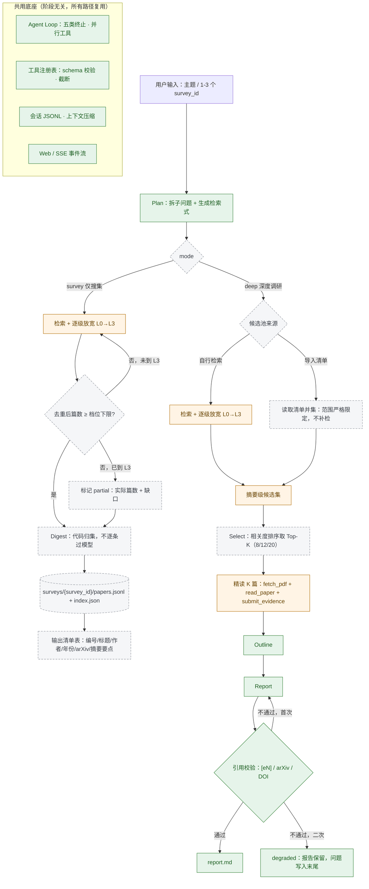

# 设计目标：litagent 文献调研智能体

> 定位：**设计说明 + 验收标准**。回答"要做什么、为什么这样做、什么算做完"。
> 与 `ROADMAP.md`（按步骤怎么实现）、`HANDOFF.md`（当前状态与坑）分工，不重复二者内容。
> 本版聚焦本轮迭代：**两种模式 × 三档位 + 清单复用 + 工作流参数化**。

---

## 1. 问题与目标

### 1.1 要解决的问题

现有实现（第 1–8 步）已经能跑通"检索 → 精读 → 证据卡 → 引用校验 → 报告"的完整链路，但存在三个结构性不足：

1. **调研规模不可控**。提示词里的"至少 N 篇"没有执行机制，模型可以只交 1 篇就走完流程（已由 `_validate_collect` 部分堵住，但阈值写死在代码里，不随任务规模变化）。
2. **只有一种调研形态**。要么精读到底写报告，要么什么也不做；缺少"只想知道这个领域有哪些论文"的低成本场景。
3. **上一轮的检索成果无法复用**。每次深度调研都要重新检索，已经搜集好的文献清单不能作为下一轮的输入。

### 1.2 目标（按优先级排序，冲突时上位覆盖下位）

| 编号 | 目标 | 含义 |
| --- | --- | --- |
| **G1** | 研究质量优先 | 报告中的每条论断可回溯到证据卡；引用的论文真实存在；覆盖度达到档位承诺。**质量冲突时优先于成本和速度**。 |
| **G2** | 覆盖可承诺、可验证 | 档位即契约：承诺的篇数下限要么达成，要么显式标注"未达成"，不允许静默降级。 |
| **G3** | 成果可复用 | 仅搜集产出的清单是一等公民产物，可被后续深度调研导入并限定候选池。 |
| **G4** | 成本可控 | 在满足 G1/G2 的前提下压低单次 token 与耗时；超出预算时优先减少精读篇数，而不是放弃引用校验。 |
| **G5** | 工程可演进 | 新模式、新档位只增加配置，不复制流程代码。 |

**取舍规则（写死，供评审）**：

- 质量 vs 成本 → 质量优先，但允许通过"降低精读篇数"降本，不允许跳过引用校验。
- 完整 vs 诚实 → 诚实优先：宁可在产物中标注"只拿到 8 篇，未达 10 篇下限"，也不假装完成。
- 覆盖 vs 耗时 → 仅搜集模式优先覆盖（可到数百篇）；深度模式优先单篇质量（精读数量和深度固定）。

### 1.3 非目标与硬约束

**硬约束（不可突破）**

- **Python 3.7 兼容**：不使用 3.8+ 语法与依赖（与现有 `PyPDF2==3.0.1` 的原因一致）。
- **本地单机单任务**：不做多用户、鉴权、分布式部署；`JobManager` 保持串行执行。

**非目标（本阶段明确不做）**

- 不做引用的**语义**校验（论断与证据是否真的对应）。现有校验只到结构级：`[eN]` / arXiv 号 / DOI 是否存在于证据库。
- 不做跨用户的共享文献库、推荐系统、自动订阅。
- 不承诺"综述结论科学正确"，只承诺"结论可追溯到原文片段"。
- 仅搜集模式**不做任何推断**——不评价、不比较、不总结趋势。

---

## 2. 能力模型：两种模式 × 三档位

### 2.1 模式定义

| | **仅搜集（survey）** | **深度调研（deep）** |
| --- | --- | --- |
| 回答的问题 | "这个方向有哪些论文？" | "这些论文说了什么，结论是什么？" |
| 是否精读全文 | 否 | 是，仅 Top-K 篇 |
| 是否做推断 | **否**，只做元数据归集 | 是，必须绑定证据 |
| 产物 | 文献清单（结构化表格） | 证据库 + 大纲 + 报告 |
| 单篇成本 | 约等于 0（不调用模型逐篇处理） | 高（摘要 + 精读 + 证据固化） |
| 适用场景 | 开题摸底、判断值不值得深挖、给深度调研准备候选池 | 写综述、答辩材料、需要逐条引用 |

### 2.2 档位即契约

档位决定**目标篇数区间**、**阶段预算**和**精读上限**，三者绑定为一组配置，不允许单独修改。

| 模式 | 档位 | 目标篇数（下限–上限） | 精读篇数 K | 说明 |
| --- | --- | --- | --- | --- |
| 仅搜集 | low | 10 – 15 | 0 | 快速摸底，单轮检索即可覆盖 |
| 仅搜集 | mid | 15 – 100 | 0 | 需要多检索式 + 分页 |
| 仅搜集 | high | 100 – 500 | 0 | 需要逐级放宽 + 分页去重；**必须由代码归集，不能把全文/全部摘要塞进模型上下文** |
| 深度 | low | 10 – 15 | 8 | 候选池读摘要，Top-8 精读 |
| 深度 | mid | 15 – 30 | 12 | |
| 深度 | high | 30 – 50 | 20 | 成本最高档，见 §7 风险 |

**契约的判定口径**：

- 篇数按 **arXiv ID 去重**（去版本后缀），同一篇的多条证据只算一篇。
- "达到下限"指**去重后进入候选池的论文数** ≥ 下限，不要求全部精读。
- 未达下限且已用尽兜底手段 → 产物标记 `partial`，写入实际篇数与缺口（见 §3）。

### 2.3 清单：一等公民产物

仅搜集的产物不是一段文字，而是可寻址、可再导入的结构化数据。

**存储**：`workspace/<session>/surveys/<survey_id>/papers.jsonl`，每条一行：

```json
{
  "arxiv_id": "2504.19413",
  "title": "...",
  "authors": ["..."],
  "year": 2025,
  "abstract": "...",
  "categories": ["cs.CL"],
  "url": "https://arxiv.org/abs/2504.19413",
  "matched_queries": ["q1", "q3"],
  "query_level": "L0",
  "rank": 1
}
```

**注册表**：`workspace/<session>/surveys/index.json`，记录 `survey_id`、主题、档位、创建时间、篇数、状态（`done` / `partial`）、检索式与兜底级别。`survey_id` 是后续导入的唯一引用方式。

**不做的事**：清单里不出现"该方法优于…""趋势是…"这类推断字段——这是仅搜集模式的边界，也是可自动检测的验收点。

### 2.4 清单导入（深度调研的第二种候选池来源）

深度调研的候选池有两种来源，二选一，不混合：

| 来源 | 触发方式 | 行为 |
| --- | --- | --- |
| 自行检索 | 只给主题 | 按档位下限自行检索，走 §3 兜底 |
| 导入清单 | 指定 1–3 个 `survey_id` | **候选池严格限定**在这些清单内的并集（去重）；不额外检索；Plan 仍拆子问题，但用于筛选与写作，不用于扩充候选 |

导入模式的取舍：**可复现性优先于覆盖度**。若导入清单并集小于档位下限，不做自动补检，直接标记 `partial` 并提示"候选池来自 N 份清单，共 M 篇，低于档位下限"。

### 2.5 全局流程图与实现状态

**选型说明**：本轮设计的实质变化是"同一套流程按 `mode`/`level` 组装不同阶段序列，并把候选池做成可注入的"，属于流程编排问题，故采用**流程图**而非分层架构图。分层职责见 §4.5 的映射表。



**图例**：绿色 = 已实现；橙色 = 部分实现（底座能力有，本轮机制缺）；灰色虚线 = 计划中。状态以当前代码为准。

> 注：Mermaid 在 GitHub 与多数 Markdown 预览器可直接渲染；不支持时按图下四张表阅读即可。

#### A. 可仿照 pi agent 实现的（框架层，有同类模块可对照）

| 能力 | pi 参考 | 本项目落点 | 状态 |
| --- | --- | --- | --- |
| LLM 适配（超时/重试/用量） | `packages/ai` | `litagent/llm/` | 已实现 |
| Agent Loop（终止条件/并行工具/续跑） | `packages/agent/agent-loop.ts` | `litagent/agent/loop.py` | 已实现 |
| 工具协议与注册表 | `types.ts`、`tool-definition-wrapper.ts` | `litagent/tools/base.py`、`registry.py` | 已实现 |
| 工具治理（hooks / 路径守卫 / 限速缓存） | `project-trust.ts`、`output-guard.ts` | `registry.py` 钩子（已写未接线）、`paths.py`（已写未调用）、`net.py` | 部分 |
| 系统提示词 + Skills 渐进式披露 | `system-prompt.ts`、`skills.ts` | `prompt/system.md`；Skills 未做 | 部分 |
| 会话持久化 + 上下文压缩 | `session-manager.ts`、`compaction/` | `session.py`、`compaction.py` | 已实现 |
| 工作流编排 / 子代理隔离 | `agent-session-runtime.ts`、`pi-subagents` | `workflow.py`（单进程顺序阶段，无子代理） | 部分 |
| 评测（golden set / 指标） | `packages/evals`、`agent-loop.test.ts` | 未开始 | 计划 |
| 交互层 | `packages/tui` | `web/server.py` + `static/index.html`（Web 替代 TUI） | 已实现 |

#### B. pi 没有、我们新加的（文献领域层与应用层）

| 新增能力 | 说明 | 状态 |
| --- | --- | --- |
| 文献工具链 | `search_arxiv` / `get_arxiv_paper` / `fetch_pdf` / `read_paper` / `save_note` / `search_notes` | 已实现 |
| 结构化提交协议 | `submit_plan` / `submit_evidence` / `submit_outline` / `submit_report` 直接写 `StageStore`，不解析模型自由文本 | 已实现 |
| 阶段产物契约 | `plan.json` / `evidence.jsonl` / `outline.md` / `report.md` + `resume` 跳过已完成阶段 | 已实现 |
| 引用结构校验 | `validate_citations` + 首次失败重写、二次失败 `degraded` 保留报告 | 已实现 |
| Collect 下限校验 | 论文数去重 + 子问题覆盖 + 总量下限，不达标走阶段重试 | 已实现（下限由档位 `target_min` 驱动） |
| 零依赖本地 Web | 标准库 HTTP + SSE + 自包含单页，无框架无构建 | 已实现 |
| **两模式 × 三档位契约** | survey / deep × low/mid/high，档位绑定目标篇数、阶段预算、精读上限 | 已实现（M1：`run_spec.py`，survey 流程待第 11 步） |
| **逐级放宽兜底** | L0 原式 → L1 拆 AND → L2 同义词 → L3 分类浏览，记录 `query_level`，用尽标 `partial` | 计划（M2） |
| **清单作为一等公民** | `surveys/{id}/papers.jsonl` + `index.json` 注册表，清单由代码归集不逐条过模型 | 计划（M2） |
| **清单导入** | 深度调研按 `survey_id` 导入 1–3 份，候选池严格限定、不自动补检 | 计划（M3） |
| **Top-K 分层精读** | 全部读摘要进候选，仅 K 篇（8/12/20）读全文并产证据 | 计划（M3） |

#### C. 已经实现的（现状盘点，可直接复用）

- **框架层**：LLM 适配与重试、Agent Loop 与五类终止、并行工具、工具协议校验与截断、限速与磁盘缓存
- **文献层**：arXiv 检索与元数据、PDF 下载与按页解析、笔记保存与检索
- **流程层**：Plan → Collect → Outline → Report 四阶段、阶段重试、产物落盘、按阶段 `resume`
- **质量层**：证据卡提交、引用结构校验、`degraded` 降级、Collect 下限校验
- **交互层**：本地 Web（阶段卡片、实时日志、计划/证据/大纲/报告四视图、事件回放）

#### D. 预计实现的（对应 §8 里程碑）

- **M1**：`RunSpec` + 档位配置表 + 档位驱动的校验器（替换写死的 `MIN_COLLECT_PAPERS`）
- **M2**：仅搜集模式、`Digest` 归集、清单与注册表、L1–L3 逐级放宽、`partial` 状态、Web 侧展示
- **M3**：摘要级候选集、`Select` Top-K、分层精读、清单导入（1–3 份）
- **M4**：Semantic Scholar 引文滚雪球、跨会话文献库、工具结果瘦身、按论文隔离上下文（子代理化）、评测 golden set 与指标

---

## 3. 兜底机制：逐级放宽检索

目标是在检索式失效（0 结果、结果过少、网络错误）时**自动降级而不是放弃**，同时保留可审计的痕迹。

| 级别 | 动作 | 触发条件 |
| --- | --- | --- |
| L0 | 原检索式（Plan 生成，AND 组合） | 默认 |
| L1 | 拆词放宽：去掉 AND 组合，改用核心词 + OR | L0 结果 < 下限 |
| L2 | 上位词 / 同义词替换，放宽分类与年份窗 | L1 仍不足 |
| L3 | 按 arXiv 分类浏览（如 `cs.CL` + 时间窗），按相关性排序取前 N | L2 仍不足 |

**规则**：

- 每条论文记录 `query_level`，清单一目了然哪些是靠放宽才拿到的。
- 网络类错误（连接失败、超时）不直接判失败：先按现有重试策略处理，仍失败则跳到下一级检索式，**不得因为一个检索式报错就终止整个阶段**。
- 全部级别走完仍不足下限 → 阶段**不失败**，产物标记 `partial`，在清单头部与 UI 阶段卡片上显式标注实际篇数与缺口。
- 导入模式不适用本机制（候选池固定，见 §2.4）。

---

## 4. 架构：一套流程 + 参数

### 4.1 核心思路

保留唯一的工作流入口，模式与档位作为**参数**注入，决定"跑哪些阶段、每阶段多少预算、校验器用哪套"。不新增分支流程，不复制重试与落盘逻辑。

```python
RunSpec(
    mode="survey" | "deep",
    level="low" | "mid" | "high",
    source=Topic("...") | Surveys(["sv_20261113_ab12", ...]),  # 1-3 份
    budgets=StageBudgets(...),   # 由 (mode, level) 查表得到
)
```

### 4.2 阶段序列

| 阶段 | 仅搜集 | 深度（自行检索） | 深度（导入清单） |
| --- | --- | --- | --- |
| Plan（拆子问题 / 生成检索式） | 是（可简化） | 是 | 是（只用于筛选与写作） |
| Collect：检索 + 兜底 | 是，产出元数据 | 是，产出摘要级候选 | 否，直接读清单 |
| Digest：归集清单 | 是（代码生成，不逐条过模型） | — | — |
| Select：按相关度选 Top-K | — | 是 | 是 |
| 精读：读全文、写证据卡 | — | 是，K 篇 | 是，K 篇 |
| Outline | — | 是 | 是 |
| Report + 引用校验 | — | 是 | 是 |

差异全部落在"阶段是否执行 + 阶段预算"这一层，阶段内部实现（提交工具、产物落盘、重试、resume）完全复用现有实现：`_run_stage` / `StageStore` / `submit_*` / `WorkflowError`。

### 4.3 参数表（初值，需实测校准）

| 参数 | 仅搜集 | 深度 |
| --- | --- | --- |
| `target_min` / `target_max` | 10/15、15/100、100/500 | 10/15、15/30、30/50 |
| `max_turns`（Collect） | 随档位提高（high 需要分页与放宽） | 随候选数提高 |
| `read_k` | 0 | 8 / 12 / 20 |
| 单次检索 `max_results` | 分页（如每页 100） | 每页 20–50 |
| 是否启用兜底 | 是 | 是（导入模式关闭） |
| 校验器 | 清单完整性 + 下限 | 现有证据校验 + 下限 + Top-K 完成度 |

### 4.4 与现有实现的映射

| 能力 | 现状 | 本轮改动 |
| --- | --- | --- |
| Agent Loop | 已完成，阶段无关 | 不改 |
| 工具注册表 | 已完成 | 检索工具增加分页参数与结构化错误 |
| 工作流 | 固定四阶段 | 改为按 `RunSpec` 组装阶段序列 |
| Collect 校验 | `MIN_COLLECT_PAPERS = 5` 写死 | 改为 `target_min`（来自档位） |
| 产物落盘 | `plan.json` / `evidence.jsonl` / `outline.md` / `report.md` | 新增 `surveys/<id>/papers.jsonl` 与 `index.json` |
| 会话 / 压缩 | 自由模式可用，工作流未接入 | 本轮不做，列入后续 |
| Web | 单任务、四阶段卡片 | 增加模式/档位选择与清单多选；阶段卡片随模式变化 |

---

## 5. 验收标准

每条都可执行、可复现。

### G1 研究质量

- [ ] 深度调研报告中每个 `[eN]` 都能在 `evidence.jsonl` 找到；`validate_citations` 返回空列表。
- [ ] 报告正文中不出现证据库之外的 arXiv 号或 DOI。
- [ ] 每条证据卡的 `quote` 能在对应 PDF 原文中定位到（抽样 10 条，命中率 100%）。
- [ ] 同一篇论文不产生重复证据卡（按 arXiv ID 去重后无重复）。

### G2 覆盖可承诺

- [ ] 六个（模式 × 档位）组合各跑一次，产物篇数落在约定区间，或状态为 `partial` 且标注实际篇数与缺口。
- [ ] 在 arXiv 不可达的场景下（可用断网或错误域名模拟），仅搜集模式仍能产出 `partial` 清单并正常退出，不抛出未捕获异常。
- [ ] 清单中每条论文都有 `query_level`，L0–L3 的分布可统计。
- [ ] 不存在"篇数不足但状态为 done"的情况（可用断言或日志检查）。

### G3 成果可复用

- [ ] 仅搜集产物可通过 `survey_id` 被深度调研导入，导入 1 份与 3 份均可运行。
- [ ] 导入模式下，深度调研候选池中不出现清单之外的论文（用集合差集断言为空）。
- [ ] 导入清单并集低于档位下限时，状态为 `partial` 且未自动补检（断言检索调用次数为 0）。
- [ ] `surveys/index.json` 可列出历史清单，包含主题、档位、篇数、状态。

### G4 成本可控

- [ ] 仅搜集模式单次运行的 LLM 调用次数与篇数**无关**（只与检索式数量相关）——high 档 500 篇不应产生 500 次模型调用。
- [ ] 深度模式记录"每篇精读的 token 开销"，high 档完整跑完的成本有实测数字并写入文档。
- [ ] 单阶段超出 `max_turns` 或预算时，状态为 `partial` 或明确失败，不静默截断。

### G5 工程可演进

- [ ] 新增一个档位只需改配置表，不改阶段流程代码（以 diff 行数验证：新增档位 ≤ 10 行）。
- [ ] 新增一种模式只需新增一份阶段序列配置，复用现有阶段实现。
- [ ] 现有自由模式（`python main.py "..."`）与 `--resume` 行为不变。

---

## 6. 现状对照

**已具备（可直接复用）**：Agent Loop 与五类终止条件、工具协议与注册表、arXiv 检索/PDF 精读、证据卡提交工具、三阶段编排与阶段重试、产物落盘与 resume、引用结构校验、Web 事件流与阶段卡片、逐级检索的底层能力（`build_search_query` 已有查询构造）。

**本轮需要新增**：`RunSpec` 与阶段序列参数化、仅搜集模式与清单产物/注册表、清单导入、Top-K 选择与精读分层、档位驱动的校验器、Web 端的模式/档位/清单选择。

**已知缺口（不在本轮处理，但会影响目标）**：工作流未接入 session/compaction（长会话无法导出）、Collect 上下文全量重发导致成本高、检索失败按 5xx 逻辑重试可能长时间阻塞、引用校验只到结构级。

---

## 7. 风险与约束

| 风险 | 影响 | 应对 |
| --- | --- | --- |
| **深度 high 档成本** | 30–50 篇摘要 + 20 篇精读。按现有实测（7 篇 / 约 23.5 万 tokens）推算，high 档可能达到 50 万 tokens 量级 | 先做工具结果瘦身与按论文隔离上下文（每篇精读独立上下文，只回传证据卡）；把实测成本写进验收标准，超标则下调 K 或分阶段交付 |
| **仅搜集 high 的上下文** | 500 篇摘要远超单次上下文 | 清单由代码生成并落盘，模型只参与检索式生成与可选的 Top-N 复核；摘要不进对话上下文 |
| **arXiv 限速** | 建议 3 秒/请求，逐级放宽 + 分页会放大请求数 | 保持全局限速器；分页每页 100；放宽级别设上限（如 L0–L3 各最多 3 条检索式） |
| **导入模式的刚性** | 候选池固定，可能远低于下限 | 明确标注 `partial` 并提示换清单/降档，不做静默补检 |
| **档位语义漂移** | 不同模式下"档位"数字不同，容易混淆 | 文档与 UI 均标注"篇数是该模式下的目标区间"，不复用绝对数字 |
| **Python 3.7** | 无法使用 `dataclass(slots=True)`、`typing.Protocol` 等 | 沿用现有写法；新依赖必须先验证 3.7 可用性 |

---

## 8. 里程碑

| 里程碑 | 内容 | 完成标志 |
| --- | --- | --- |
| **M1 参数化** | `RunSpec` + 阶段序列配置 + 档位驱动的校验器；现有四阶段行为不变 | G5 验收通过；现有主题回归跑通 |
| **M2 仅搜集** | 检索 + 兜底 + 清单归集 + 注册表 + Web 展示 | G2、G4 中仅搜集相关项通过 |
| **M3 深度分层** | 摘要级候选 → Top-K 选择 → 精读 → 报告；导入清单 | G3 通过；deep high 有实测成本数字 |
| **M4 检索增强与成本** | Semantic Scholar 引文滚雪球、跨会话文献库、工具结果瘦身、按论文隔离上下文 | G1/G4 指标有基线可比 |

评测（golden set、召回率、引用真实率、证据覆盖率、工具失败率）贯穿各里程碑，不单独作为最后一个里程碑。

---

## 9. 与其他文档的关系

- `ROADMAP.md`：第 1–8 步的实现路径，已完成；本轮的 M1–M4 是其第 8 步的扩展与第 9 步的并行推进。
- `HANDOFF.md`：当前代码状态、已验证内容与已知坑；本文档的"现状对照"只列与目标相关的差异，不复述坑列表。
